<h1 align="center">Hi, I'm Israr Ahemad Khan 👋</h1>
<h3 align="center">Cloud & DevOps Engineer · AWS · Microsoft Azure · DevSecOps</h3>

I build secure, automated cloud infrastructure and delivery pipelines.

  
  
  

---

## About me

I’m a Cloud and DevOps Engineer focused on AWS and Microsoft Azure. I work across infrastructure as code, containers, Kubernetes, CI/CD automation, and security checks that help teams ship reliably.

- ☁️ Build and manage cloud infrastructure on AWS and Azure
- ⚙️ Automate builds and deployments with GitHub Actions, Jenkins, and Azure DevOps
- ☸️ Work with Docker, Kubernetes, Amazon EKS, and Helm
- 🔐 Add code, image, and secret scanning to delivery pipelines
- 📍 Nagpur, Maharashtra, India

## What I build

- **DevSecOps pipeline on Amazon EKS** — Java build and tests, code quality checks, security scans, image publishing, and Kubernetes deployment.
- **AWS three-tier architecture** — Highly available application and data tiers with VPC network isolation, load balancing, and database security.
- **Jenkins CI/CD pipeline** — Automated application build, testing, container image creation, and AWS deployment.

## Tech stack

**Cloud & infrastructure**  

**Containers & delivery**  

**Security & observability**  

**Languages & scripting**  

## Certifications

## Currently exploring

**GitOps · MLOps · AI-assisted operations** — practical ways to improve repeatability, deployment safety, and day-to-day cloud operations.

## GitHub at a glance

  
  

<i>Stats refresh automatically every day.</i>

## Let’s connect

I’m always happy to talk about cloud infrastructure, DevOps automation, Kubernetes, or DevSecOps.

- **Email:** [er.israrkhan@gmail.com](mailto:er.israrkhan@gmail.com)
- **LinkedIn:** [Israr Ahemad Khan](https://linkedin.com/in/israr-ahemad-khan-68b2b0167)
- **GitHub:** [@israrakhan](https://github.com/israrakhan)

